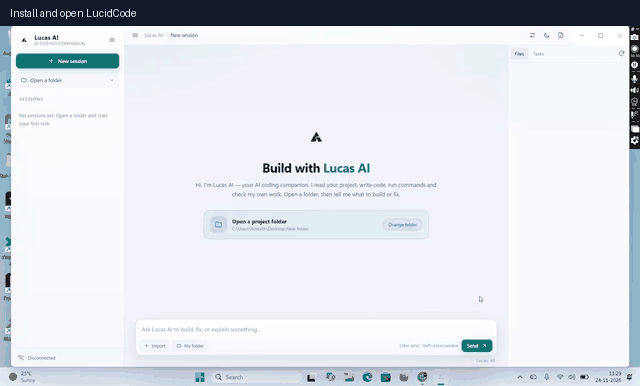
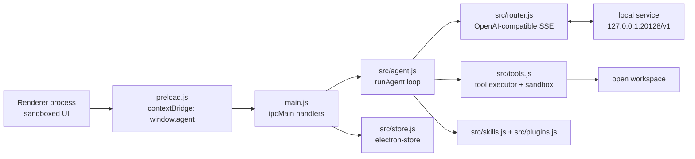

# LucidCode Guide

<div align="center">


[Demo](#demo) · [Plain English](#part-1--plain-english-guide) · [Frontend technologies](#frontend-technologies) · [Technical reference](#part-2--technical-reference)

</div>

This guide has two parts:

1. **Plain-English guide** — for anyone who just wants to use LucidCode.
2. **Technical reference** — for developers who want to know exactly what the code does.

A short demo GIF is included below so you can see what was built before you read.

---

## Demo



The GIF shows the whole idea: install the app, ask for a simple contact form, watch the agent work through its steps, and review the finished `form.html`.

---

# Part 1 — Plain English Guide

## What is LucidCode?

LucidCode is a helper that lives on your computer and works inside a folder you choose.

You open a folder, tell the helper what you want in ordinary words, and it:

- reads the files in that folder,
- writes or changes the files needed,
- runs commands to check the work,
- fixes problems it finds,
- and tells you, in plain language, what it changed.

The assistant inside the app is called **Lucas AI**. The app itself is **LucidCode**.

## What can you ask it?

| You say | What happens |
| --- | --- |
| "Explain this project to me" | It reads the files and explains them simply |
| "Make a contact form and save it as form.html" | It creates the file, writes the page, and shows you the result |
| "Fix this error" | It looks at the error, edits the file, and tries again |
| "Write a README" | It creates an easy guide for the project |
| "Check if everything works" | It runs the project's checks and reports the result |

You do not have to write code. You only describe the result you want.

## The only three things you need

1. **A computer** — Windows, macOS, or Linux.
2. **Node.js** (only if you run from source) — install it from `nodejs.org`.
3. **An AI service with a key** — LucidCode needs a place to "think". The usual one is a local service called `9router`. The **API key** is like a password that lets the app use that service.

Your project files stay in your folder. The app does not send them anywhere except to the service you set up yourself.

## Get it running

### Using the installer (easiest)

1. Download `LucidCode-Setup-1.0.1.exe`.
2. Double-click it.
3. Choose **Only for me** and click **Next**.
4. Click **Install**, wait, then click **Finish**.
5. Open LucidCode.

### Running from source

Open a terminal in the project folder and run:

```text
npm install
npm start
```

## Your first conversation

1. On the welcome screen, click **Open a project folder** and pick a folder.
2. Press `Ctrl + ,` (`Cmd + ,` on Mac) to open **Settings → Connection**.
3. Paste your API key, click **Test connection**, then click **Save settings**.
4. In the message box at the bottom, type:

   > `Hi! Explain what this folder contains.`

5. Press **Enter**. The answer appears piece by piece.
6. If the app asks whether it may change a file, read the small message and choose.

That is the whole workflow. Bigger tasks are just the same steps repeated.

## When it asks permission

| Button | Meaning in plain words |
| --- | --- |
| **Allow once** | Yes, but ask me again next time |
| **Always allow** | Yes, and stop asking for this kind of action |
| **Deny** | No, do not do that |

Use **Allow once** until you feel comfortable. Use **Always allow** only for folders you trust.

## Good prompts to copy

- `Read this folder and tell me what the project does in simple words.`
- `Create a simple contact form with name, email, and message. Save it as form.html.`
- `Find the mistake in this project and fix it. Tell me what you changed.`
- `Write a short README that explains how to run this project.`
- `Run the checks and tell me if everything is okay.`

Clear instructions give better results.

## Where things are saved

- Your project files stay in the folder you opened.
- Your settings, chat history, and tasks are saved on your computer under the `9Agent` folder in your application data directory.
- Nothing is tracked. There is no hidden reporting.

## If something looks wrong

| Problem | Try this |
| --- | --- |
| It says **Disconnected** | Start your AI service or click **Start** in the app, then check that the status shows online |
| It says **could not authenticate** | Your key is wrong or expired. Put a fresh one in **Settings → Connection** |
| It does not answer | Make sure a model is selected, then send the message again |
| It asks permission too often | Choose **Always allow** in a folder you trust |
| A task stops after 30 steps | Tell it `continue`, or raise `maxSteps` in Settings |
| A command seems stuck | Click **Stop** |

## Small words you will see

| Word | Plain meaning |
| --- | --- |
| **Workspace** | The folder you opened |
| **Model** | The AI brain you are talking to |
| **Session** | One chat; you can have several |
| **Tool** | One action the assistant can do, such as read a file |
| **Step** | One piece of work; large jobs use up to 30 steps |
| **API key** | The password for your AI service |
| **Approval** | Your "yes, go ahead" before a change is made |

---

# Part 2 — Technical Reference

This part describes what the implementation actually does. It follows the same path as the code: Electron shell → bridge → main process → agent → router and tools → storage → renderer.

## 1. Process model

LucidCode uses three Electron layers:



The renderer has no `require`, no `fs`, and no `child_process`. Every privileged action crosses the bridge as an IPC invoke and is handled in the main process.

## 2. Startup sequence (`main.js`)

1. `app.setName('9Agent')` and `app.setPath('userData', <appData>/9Agent)` keep the legacy data location so existing sessions and settings still load.
2. Modules are loaded: `store`, `router`, `runAgent`, `resolveInside`, skill and plugin discovery.
3. `createWindow()` builds a `BrowserWindow` (1480 × 930, minimum 980 × 620) with:
   - `preload: preload.js`
   - `contextIsolation: true`
   - `nodeIntegration: false`
   - `sandbox: true`
   - theme-aware background, title-bar overlay, and contrasting app icon.
4. `registerIpc()` installs the handlers listed below.
5. `bootstrapRouter()` calls `GET /models`; if the service is down and `autoStartRouter` is on, it locates or installs `9router`, spawns it, and polls for up to roughly 90 seconds. Status is broadcast to the renderer.
6. `theme-boot.js` applies the saved theme before first paint to avoid a flash.

## 3. The bridge (`preload.js`)

`contextBridge.exposeInMainWorld('agent', …)` exposes a fixed API. There is no generic IPC escape hatch.

| Group | Methods |
| --- | --- |
| App/settings | `getState`, `saveSettings`, `quit`, `openUrl`, `setTheme` |
| Service | `routerStatus`, `startRouter` |
| Sessions | `createSession`, `getSession`, `deleteSession`, `renameSession` |
| Tasks | `listTasks`, `addTask`, `updateTask`, `removeTask`, `clearCompletedTasks` |
| Workspace | `chooseWorkspace`, `setWorkspace`, `toggleFavoriteWorkspace`, `tree`, `readFile`, `revealFile`, `openFile` |
| Agent | `send`, `stop`, `respondApproval` |
| Extensions | `getExtensions`, `saveExtensions`, `listSkills`, `listPlugins` |
| Events | `onAgentEvent`, `onRouterStatus`, `onSessionsChanged`, `onWorkspacesChanged`, `onSettingsChanged`, `onExtensionsChanged`, `onTasksChanged` |

Each subscription returns an unsubscribe function that removes its `ipcRenderer` listener.

## 4. IPC handlers (`main.js`)

| Channel | Purpose |
| --- | --- |
| `app:state`, `settings:save`, `ui:set-theme`, `app:quit` | App state and preferences |
| `router:status`, `router:start`, `router:open-url` | Service status, start, and safe external link opening |
| `session:create/get/delete/rename` | Session lifecycle |
| `tasks:list/add/update/remove/clear-completed` | Per-session task queue |
| `workspace:choose/set/toggle-favorite/tree/read-file/reveal/open-file` | Workspace selection and file preview |
| `chat:send`, `chat:stop`, `approval:respond` | Agent execution and human decisions |
| `extensions:get/save`, `skills:list`, `plugins:list` | Extension configuration and discovery |

Outbound events use `webContents.send`: `agent:event`, `router:status`, `sessions:changed`, `workspaces:changed`, `settings:changed`, `extensions:changed`, `tasks:changed`.

## 5. Agent loop (`src/agent.js`)

`runAgent({ session, settings, emit, requestApproval, signal, extensions })` does the following:

1. Clamps `maxSteps` to 1–100 (default 30) and creates a tool executor for the session workspace.
2. Gathers workspace/global skills and plugin tools; merges plugin tools with `TOOL_DEFINITIONS`.
3. For each step:
   - emits `{ type: 'step', step, maxSteps }`,
   - builds `[system prompt, ...trimHistory(messages)]` with a 120k-character history budget,
   - streams `streamChat()` events and accumulates `text`, `reasoning`, tool-call fragments, and token usage,
   - reconstructs tool calls from streamed fragments, generating fallback ids when needed,
   - retries once with "Please continue and give the final answer." if a turn produces neither text nor tool calls,
   - appends the assistant message to history and emits `assistant`,
   - if there are no tool calls, emits `done` with usage and returns,
   - otherwise classifies each call with `permissionFor()`, executes approved calls, appends results to history, and continues the loop.
4. `AbortSignal` cancels cleanly; on stop, pending approval resolvers are resolved as `false`.

`consultSpecialist()` delegates a role (frontend, backend, DevOps, database, QA, security, mobile, UI/UX, architecture) to a role-matched model. `pickModelForRole()` maps roles to available model ids. `trimHistory()` keeps the recent context within budget.

Event types emitted to the UI: `step`, `text`, `reasoning`, `assistant`, `tool-result`, `todos`, `usage`, `approval-request`, `done`, `run-end`, and errors.

## 6. Tools (`src/tools.js`)

`TOOL_DEFINITIONS` exposes twelve tools:

| Tool | Function |
| --- | --- |
| `read_file` | Numbered file content with `offset` and `limit` |
| `write_file` | Create or replace a file |
| `edit_file` | Exact-string replacement with a generated line diff; `replace_all` supported |
| `list_files` | Indented tree (depth capped at 8, up to 4000 entries) |
| `glob_files` | Glob pattern matching via a converted regex |
| `grep_files` | Regex search returning `path:line` results |
| `run_command` | PowerShell command in the workspace, default timeout 120 s, max 10 min, process-tree kill on stop |
| `web_fetch` | Fetch a URL and convert the response to readable text |
| `update_todos` | Synchronize the Tasks panel |
| `list_skills`, `use_skill` | Discover and load Markdown skill instructions |
| `consult_specialist` | Delegate a domain task to another model |

`permissionFor()` maps tools to approval classes:

- `write_file` / `edit_file` → `write`
- `run_command`, `plugin_*` → `command`
- `web_fetch` → `network`
- everything else → `read`

`resolveInside(workspace, input)` resolves user paths and rejects paths outside the workspace. `displayPath()` renders relative paths for prompts. `lineDiff()` produces the diff shown in approval cards. `clip()` bounds tool output before it returns to the model. `isProbablyBinary()` and the directory skip list keep traversal safe.

The executor returns `{ execute }`; results are appended to the conversation with tool metadata.

## 7. Service client (`src/router.js`)

- `apiBase()` normalizes the base URL and appends `/v1` when missing.
- `headers()` adds `Content-Type: application/json`, `Accept: text/event-stream`, and `Authorization: Bearer <key>` when a key exists.
- `listModels()` calls `GET /models`.
- `streamChat()` posts to `/chat/completions` and parses SSE frames into `text`, `reasoning`, `tool_call`, and `usage` events.
- `readError()` converts HTTP statuses into friendly messages: 400 switches-model hints, 401/403 auth, 404 temporary reachability, 429 busy, 5xx temporary failure. `RouterError` carries the original status code.

All network access lives in the main process. The renderer can only ask for status or ask the main process to open a URL externally.

## 8. Persistence (`src/store.js`)

`electron-store` writes to `%APPDATA%/9Agent/config.json`.

Default settings:

| Setting | Default |
| --- | --- |
| `baseUrl` | `http://127.0.0.1:20128/v1` |
| `apiKey` | empty |
| `model` | empty |
| `temperature` | `0.4` |
| `maxSteps` | `30` |
| `autoApproveReads` | `true` |
| `autoApproveWrites` | `false` |
| `autoApproveCommands` | `false` |
| `autoStartRouter` | `true` |
| `theme` | `dark` |

`saveSettings()` clamps `maxSteps` to 1–100, clamps temperature to 0–2, validates the theme, and encrypts `apiKey` through Electron `safeStorage` when available. `publicSettings()` never exposes the real key; it returns `hasApiKey` instead.

Other exported groups: `settings`, `extensions`, `sessions`, `getSession`, `createSession`, `saveSession`, `deleteSession`, `renameSession`, `getTaskQueue`, `saveTaskQueue`, `addUserTask`, `updateUserTask`, `removeUserTask`, `clearCompletedUserTasks`, `workspaces`, `addWorkspace`, `removeWorkspace`, `sessionSummaries`.

## 9. Renderer (`renderer/`)

| File | Responsibility |
| --- | --- |
| `index.html` | App shell and Content-Security-Policy (`default-src 'self'`, `connect-src 'none'`) |
| `theme-boot.js` | Applies saved theme before first paint |
| `style.css` | Dark/light themes and all UI components |
| `app.js` | Chat streaming, Markdown rendering, approval cards, file tree, sessions, tasks, settings modals |
| `vendor/marked.umd.js` | Markdown parsing, bundled locally |
| `vendor/purify.min.js` | HTML sanitization before rendering model output |
| `vendor/highlight.min.js`, `hljs-theme.css` | Offline code highlighting |
| `assets/` | Icons and author image |

The renderer subscribes to `agent:event` and updates the UI from typed events instead of reaching into Node APIs.

## 10. Frontend technologies

The user-facing side of LucidCode is built with these languages and libraries:

| Layer | Language / technology | Where it is used |
| --- | --- | --- |
| Markup | **HTML5** | `renderer/index.html` — the app shell, panels, buttons, and message area |
| Styling | **CSS3** | `renderer/style.css` — dark/light themes, layouts, and every UI component |
| UI logic | **JavaScript (browser)** | `renderer/app.js` — chat, streaming updates, Markdown rendering, approval cards, file tree, sessions, and tasks |
| Early theme | **JavaScript (inline)** | `renderer/theme-boot.js` — applies the saved theme before the first paint |
| Desktop shell | **Electron 45** | `main.js`, `preload.js` — window, IPC bridge, menus, and service lifecycle |
| Main-process code | **JavaScript (Node.js / CommonJS)** | `src/*.js` — agent loop, tools, router, storage, skills, and plugins |
| Runtime | **Node.js 22.12+** | Runs the main process and the build tooling |
| Markdown rendering | **Marked** (bundled) | Converts assistant Markdown into HTML |
| HTML safety | **DOMPurify** (bundled) | Sanitizes rendered HTML before it reaches the page |
| Code highlighting | **highlight.js** (bundled) | Colors code blocks in chat and previews |
| Command execution | **PowerShell** | Used by the `run_command` tool inside the workspace |

In short: the interface is **HTML + CSS + JavaScript**, running inside **Electron**, with **Node.js** behind it. All third-party renderer libraries are bundled locally, so the UI works offline.

## 11. Security boundaries

- `contextIsolation: true`, `nodeIntegration: false`, `sandbox: true`
- Only the explicit `preload.js` API is exposed
- CSP blocks remote scripts, styles, and network calls from the page
- File and process work happens only in the main process
- Tool paths are confined to the workspace, including symlink/`realpath` checks for previews
- Model Markdown is sanitized with DOMPurify before insertion
- API keys are stored locally and sent only to the configured service URL
- No telemetry

## 12. Extensions

- `src/skills.js` discovers Markdown skills in workspace/global skill folders and loads their instructions.
- `src/plugins.js` reads local plugin manifests and contributes `plugin_*` tools.
- Both are gathered at the start of an agent run and included in the system context.

## 13. Build and release

```text
npm run pack        # unpacked Windows app
npm run build       # Windows NSIS + portable
npm run build:win / build:mac / build:linux
```

`package.json` configures `electron-builder` for Windows NSIS and portable, macOS DMG/ZIP (x64 + arm64), and Linux DEB/tar.gz (x64 + arm64). `.github/workflows/build.yml` builds all combinations on `workflow_dispatch` and uploads artifacts.

## 14. Quick file map

```text
main.js                    Electron shell, IPC, service lifecycle, agent run ownership
preload.js                 Context bridge — the only renderer surface
src/agent.js               System prompt, history trimming, tool loop, specialists
src/router.js              OpenAI-compatible SSE client and error mapping
src/tools.js               Tool definitions, executor, path sandbox, diffs
src/store.js               Settings, sessions, tasks, workspaces, key encryption
src/skills.js              Markdown skill discovery
src/plugins.js             Plugin discovery and tool execution
src/mcp.js                 Legacy MCP helper, not wired into the current app
renderer/index.html        UI shell and CSP
renderer/app.js            UI behavior and event handling
renderer/style.css         Theme and component styles
renderer/theme-boot.js     Pre-paint theme application
renderer/vendor/           Offline Marked, DOMPurify, highlight.js
renderer/assets/           Icons and images
build/                     Packaging icon, installer script, images
docs/ARCHITECTURE.md       Extended diagrams and data-flow reference
.github/workflows/         CI build matrix
```

---

**Version 1.0.1 · MIT · Developed by Aniketh Dey**
